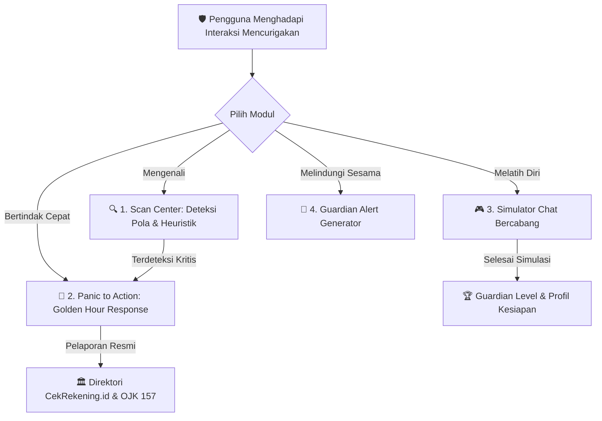

# 🛡️ Tuntun (Tuntun.id) - Navigasi & Perlindungan Ruang Digital
> **Empowering Today's Generation to Recognize, Learn, & Act Against Cyber Deception**  
> *Karya Web App untuk MIT-Week 2026: Guardians of the Digital Space*

[](#)
[](#)
[](#)

---

## 📌 1. Latar Belakang Masalah
Anak muda Indonesia setiap hari berhadapan dengan aneka ragam kejahatan siber:
- **Tawaran kerja palsu (Task Scams)**: Misi "like video YouTube / TikTok" dengan jebakan deposit ratusan ribu hingga jutaan rupiah.
- **Malware Android (.APK Banking Trojan)**: File undangan pernikahan atau resi kurir paket berkedok dokumen foto yang menyadap seluruh SMS dan kode OTP perbankan.
- **Pencurian identitas & akun (Social Engineering)**: Teman atau kerabat fiktif yang meminjam dana darurat dengan nomor baru atau akun media sosial yang dibajak.
- **Phishing finansial**: Tautan undian Shopee, DANA Kaget, atau peringatan blokir akun palsu berakhiran domain murah (`.xyz`, `.site`, `.top`).

Ketika seseorang menjadi target atau bahkan **terlanjur mengeklik link/mentransfer dana**, kepanikan sering kali membuat mereka tidak tahu langkah darurat apa yang harus diambil dalam menit-menit pertama (*Golden Hour*).

---

## 🚀 2. Solusi Tiga Pilar: Recognize, Learn, & Act

Aplikasi **Tuntun** dirancang dengan pendekatan mendalam dan terintegrasi:



### A. RECOGNIZE (Mengenali - Scan Center)
1. **Satu Kolom Input Pintar (Smart Input)**:
   - Secara otomatis mendeteksi tipe masukan: Tautan Web (URL), Nomor Telepon Internasional/Lokal, Nomor Rekening Bank, atau Teks Pesan Percakapan.
2. **Text Highlighter Interaktif**:
   - Kata dan frasa manipulatif disorot langsung dengan kode warna risiko (Merah: Bahaya Kritis, Kuning: Manipulasi Psikologis/Urgensi, Biru: Tautan Berisiko).
   - Pengguna dapat mengarahkan kursor atau mengeklik kata yang disorot untuk membaca alasan mengapa frasa tersebut merupakan *red flag*.
3. **Analisis Anatomi URL Tanpa Membuka Tautan Secara Berbahaya**:
   - Membedah protokol (HTTP vs HTTPS), domain utama, dan path file.
   - Mendeteksi *Typosquatting* / peniruan merek bank/e-commerce Indonesia (seperti `bca-klik-auth.xyz` vs `klikbca.com` resmi).
   - Mendeteksi pemendek URL (`bit.ly`, `s.id`, `linktr.ee`), direct IP address, dan ekstensi berbahaya (`.apk`, `.exe`).
4. **Skor Pola & Gauge Speedometer (0 - 100%)**:
   - Memberikan kesimpulan risiko terukur dan rekomendasi tindakan praktis.
   - Tombol instan contoh kasus nyata (*Surat Tilang .APK, Loker Like Video, Phishing BCA, Giveaway DANA*) untuk kemudahan demonstrasi juri.

### B. LEARN (Belajar - Simulator Keputusan Bercabang)
1. **Antarmuka Chat Realistis (WhatsApp/DM Style)**:
   - Menghadirkan pengalaman menyerupai aplikasi perpesanan nyata dengan alur balon pesan bertahap dan lampiran file.
2. **5 Skenario Nyata Pemuda Indonesia**:
   - 📦 *Kurir Ekspedisi J&T & File .APK* (Modus malware penyedot SMS m-banking).
   - 💼 *Loker Freelance Like Video YouTube* (Modus jebakan deposit VIP / task scam).
   - 👤 *Teman Akrab Pinjam Uang dengan Nomor Baru* (Modus impersonasi foto profil & rekayasa sosial).
   - 🎁 *Giveaway Saldo DANA & Undian Shopee* (Modus phishing pencurian PIN/OTP).
   - 📈 *Investasi Saham/Kripto Cuan 50% Seminggu* (Modus titip dana Ponzi & pinjol ilegal).
3. **Konsekuensi Nyata & Guardian Insight**:
   - Setiap pilihan memiliki reaksi balasan dan penilaian keamanan.
   - Kotak *Guardian Insight* membongkar teknik psikologis yang digunakan pelaku (seperti *Loss Aversion, Scarcity, Foot-in-the-door, Reciprocity trap*).
4. **Dua Mode Kesulitan**:
   - *Mode Panduan*: Menampilkan petunjuk tanda bahaya.
   - *Mode Waspada Pro*: Uji insting mandiri tanpa bantuan.

### C. ACT (Bertindak - Panic to Action / Pertolongan Pertama Digital)
1. **Pilihan 5 Kondisi Kritis Nyata**:
   - 🔐 Terlanjur Kirim OTP atau Kata Sandi Akun
   - 💸 Sudah Terlanjur Transfer Uang ke Rekening Penipu
   - 📲 Terlanjur Klik Link & Menginstal File .APK Palsu
   - 🪪 Data Pribadi Bocor (KTP, Foto Selfie Wajah, KK)
   - 👤 Akun WhatsApp atau Media Sosial Diambil Alih (Dibajak)
2. **Protokol Waktu Emas (Golden Hour Response)**:
   - Prioritas Menit Ini Juga (Prioritas #1 penyelamatan saldo dan pemutusan jaringan).
   - Checklist interaktif dengan bar progres penyelesaian yang tersimpan otomatis di perangkat.
3. **Template Pesan Darurat Siap Salin**:
   - Template pembekuan rekening bank darurat ke Call Center.
   - Template klarifikasi penyalahgunaan NIK.
   - Template siaran broadcast ke kerabat bahwa akun sedang disusupi.

### D. FITUR PENDUKUNG (Nilai Tambah & Perlindungan Komunitas)
- **Guardian Alert Generator**: Generator kartu peringatan visual untuk dibagikan ke grup WhatsApp keluarga. Dilengkapi **fitur sensor otomatis (*Auto-Anonymizer*)** nomor telepon dan nama untuk melindungi privasi dan etika hukum.
- **Security Checkup**: Audit mandiri 8 kebiasaan keamanan akun digital dengan skor kesiapan (0-100) tanpa pernah meminta sandi/kredensial pengguna.
- **Direktori Resmi Kanal Pelaporan Indonesia**: Informasi resmi dan tautan langsung ke **CekRekening.id (Kominfo)**, **PatroliSiber.id (Polri)**, **Kontak OJK 157**, dan hotline darurat bank nasional.
- **Profil & Gamifikasi Guardian Level**: Melacak akumulasi pengalaman (XP) dari simulasi dan checklist untuk memotivasi peningkatan literasi keamanan.

---

## 🔒 3. Kepatuhan Batasan Keamanan & Privasi

Sesuai dengan ketentuan juknis MIT-Week 2026:
1. **Nol Pengumpulan Data Sensitif (*Zero-Data Harvesting*)**:
   - Seluruh pemrosesan teks, tautan, dan nomor telepon berjalan **100% di sisi klien (Client-Side Browser)** menggunakan JavaScript murni.
   - Tidak ada transmisi data pesan ke server backend pihak ketiga.
2. **Simulasi Aman & Fiktif**:
   - Seluruh skenario simulasi menggunakan skrip aman tanpa pernah mengeksekusi atau menyebarkan kode malware nyata.
3. **Transparan & Jujur Mengenai Keterbatasan**:
   - Sistem menegaskan bahwa hasil analisis heuristik adalah panduan probabilitas dan kewaspadaan edukatif, bukan vonis mutlak jaminan hukum. Pengguna selalu diarahkan untuk melakukan verifikasi ganda pada kanal resmi.
4. **Kendali Penuh Pengguna**:
   - Disediakan tombol **"Hapus Seluruh Data Lokal"** untuk membersihkan memori `localStorage` peramban kapan saja.

---

## 💻 4. Teknologi & Desain Estetika (Software Design System)

- **Frontend**: Vanilla HTML5, Vanilla CSS3 Modern, Vanilla JavaScript (ES6+ Modular).
- **Design System**:
  - Mengadopsi prinsip desain visual **Software** modern: halaman terbuka terang (*open light page* `#fcfcfd`) dipadukan dengan tipografi judul sans-serif gelap tegas, aksen aksi biru elektrik (*electric-blue* `#074ce0`), dan kartu panel putih bersudut lengkung 12px berbayang lembut.
  - **Dua Bagian Gelap (*Dual Substantial Dark Passages*)**: Menggunakan bidang gelap berkesinambungan (`#16191f`) pada alur pertolongan pertama darurat (*Panic to Action Golden Hour*) serta bagian penutup (*closing & footer*) untuk menciptakan atmosfer keseriusan dan fokus penanganan insiden.
  - **Layout Hero 1.45:1 & Diagram Produk Konseptual**: Membuka halaman dengan rasio kolom 1.45:1, dilengkapi diagram produk dengan simpul pusat biru gradien dan ubin putih statis untuk konsep nyata (*File .APK Kurir, Phishing Bank, Urgensi WA, Nomor Asing*), serta bilah pembatas fakta pendukung (*ruled strip*).
  - **Tipografi Otoritatif**: Google Fonts **Host Grotesk** (display, headings, dan angka besar dengan *tight tracking*) serta **Instrument Sans** (paragraf, kontrol form, label), didukung **JetBrains Mono** untuk inspeksi URL.
  - **Pengungkapan Asli (*Native Disclosures*)**: Menggunakan elemen native `<details>` dan `<summary>` dengan baris bergaris tipis dan ikon plus yang berotasi saat dibuka.
  - **Aksesibilitas & Gerakan Terbatas (*Reduced Motion*)**: Kontrol keyboard ramah aksesibilitas dengan fokus outline terlihat jelas, serta dukungan penuh preferensi `prefers-reduced-motion`.
- **Web Audio Synthesizer**: Efek suara mikro-interaksi sintetis murni menggunakan Web Audio API (bebas dari risiko *broken file / 404 audio*).

---

## 🧪 5. Menjalankan Aplikasi Secara Lokal

Aplikasi tidak memerlukan tahapan *build* atau instalasi dependensi rumit:

```bash
# 1. Masuk ke direktori proyek
cd guardian-digital

# 2. Jalankan server lokal (menggunakan Node.js bawaan)
node server.js

# 3. Buka di peramban web:
# http://localhost:8080
```

Atau cukup klik dua kali berkas `index.html` untuk langsung membukanya di browser apa pun!

### Menjalankan Uji Otomatis (Automated Test Suite)
```bash
node test_suite.js
# Output: 21/21 Unit & Integration Tests Passed (100% Success)
```

---

## 👥 6. Panduan Singkat untuk Dewan Juri

1. **Uji Scan Center**:
   - Buka halaman utama, klik salah satu tombol sampel instan seperti **"📱 Surat Tilang .APK"** atau **"💳 Phishing Bank BCA"**.
   - Amati bagaimana kata-kata berbahaya langsung disorot dengan penjelasan interaktif dan diagram risiko.
2. **Coba Jalur Panik Terintegrasi**:
   - Klik tombol **"🚨 Buka Panduan Darurat"** pada hasil scan untuk melompat langsung ke langkah pertolongan pertama Golden Hour.
   - Coba centang langkah-langkah checklist dan perhatikan progres bertambah secara dinamis.
3. **Coba Simulator Chat**:
   - Buka menu **Simulator**, pilih skenario *Kurir Paket J&T*, dan pilih tindakan responsif. Amati bagaimana *Guardian Insight* memberikan umpan balik edukatif atas setiap pilihan.
4. **Coba Guardian Alert & Sensor Privasi**:
   - Buka menu **Guardian Alert**, amati bagaimana nomor telepon dan data rekening otomatis disamarkan (`+62 812-XXXX-XXXX`), lalu klik **Salin Teks Broadcast WhatsApp**.

---
*Dibuat dengan dedikasi penuh untuk memberdayakan generasi muda Indonesia sebagai **Guardians of the Digital Space**.* 🛡️🇮🇩
